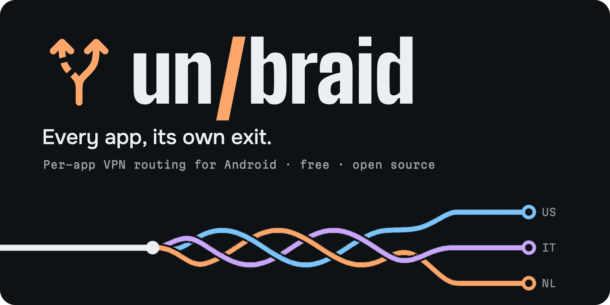
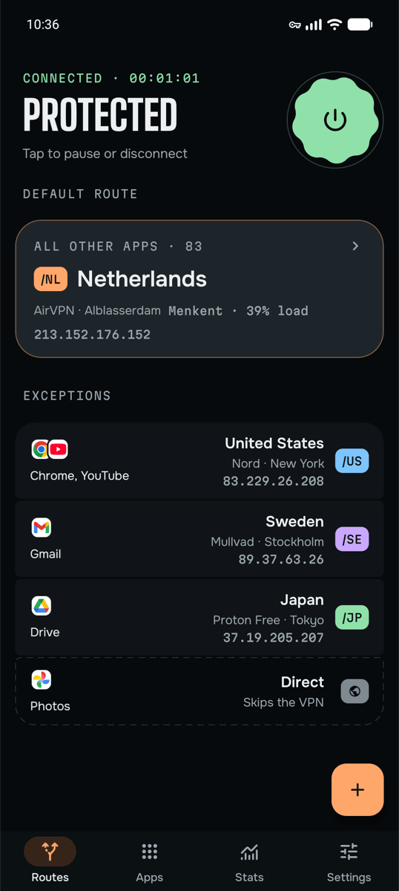
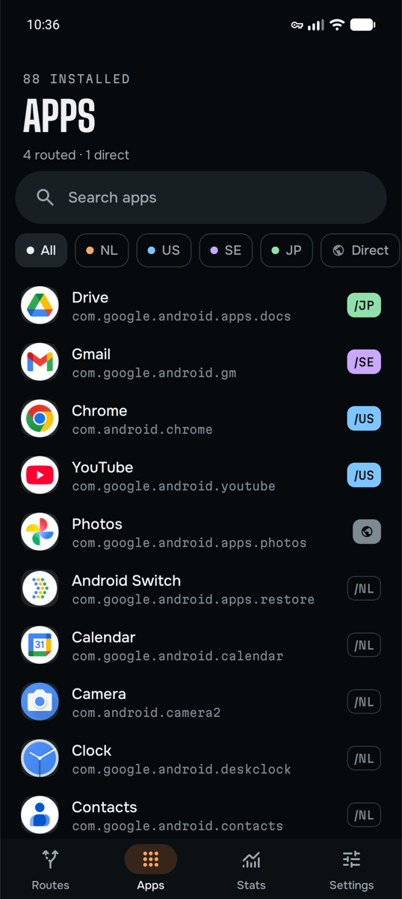
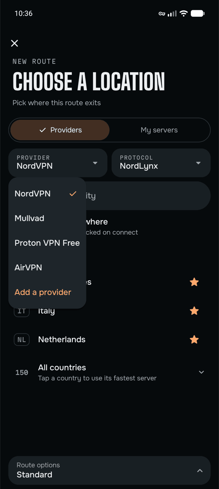
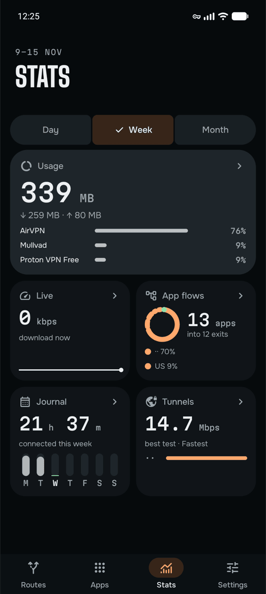

<p align="center">
  
</p>

<p align="center">
  <a href="https://github.com/quiet-crafts/unbraid/releases/latest"></a>
  
  <a href="LICENSE"></a>
  <a href="https://unbraid.app"></a>
</p>

unbraid is a split tunneling VPN client for Android that lets every app take its own exit. Your banking app can skip the VPN
while a streaming app leaves from the US, a second app from Italy and everything else from the Netherlands, all
at the same time. If you use Tailscale, your home network stays reachable too.

<p align="center">
  <a href="https://github.com/quiet-crafts/unbraid/releases/latest"><b>Download the APK</b></a>
  &nbsp;·&nbsp; <a href="https://unbraid.app">Website</a>
  &nbsp;·&nbsp; <a href="https://unbraid.app/privacy">Privacy policy</a>
  &nbsp;·&nbsp; <a href="https://github.com/quiet-crafts/unbraid/issues">Report a bug</a>
</p>

<table align="center">
  <tr>
    <td align="center" width="25%"></td>
    <td align="center" width="25%"></td>
    <td align="center" width="25%"></td>
    <td align="center" width="25%"></td>
  </tr>
  <tr>
    <td align="center"><sub>Each app gets its own exit</sub></td>
    <td align="center"><sub>See every app's route at a glance</sub></td>
    <td align="center"><sub>Mix providers and countries</sub></td>
    <td align="center"><sub>Usage, speed and connected time</sub></td>
  </tr>
</table>

## Highlights

- Give any app its own exit country or server, or let it skip the VPN with Direct. Several exits stay connected at
  once.
- Use the VPN accounts you already have. One route can go through Mullvad while another uses NordVPN.
- Reach your home network through Tailscale or Headscale, or send chosen apps out through a Tailscale exit node.
- A low-load server is picked for you when the provider publishes load, or you can pin one server yourself.
- Ad and tracker blocking per route with the provider's own blocking DNS, where it has one.
- Saved profiles, a home-screen widget, a quick-settings tile and a pause that reconnects by itself.
- Stats on the phone: data per provider, connected time and speed tests across several exits at once.
- No ads, no unbraid account and no analytics of our own. Free software under the GPL.

## What it works with

You bring the VPN. unbraid has no servers of its own and works with the accounts and servers you already have.

You can sign in with NordVPN (NordLynx, OpenVPN, Double VPN and Onion over VPN), Mullvad, Private Internet Access,
IVPN or ExpressVPN. For Proton VPN (Free included) and Surfshark you add your WireGuard key once, and for
Windscribe and AirVPN you paste one WireGuard config from their website. After that you choose from the servers
your plan includes. You can also import your own WireGuard or OpenVPN config, paste a Shadowsocks
key, or join a Tailscale tailnet (a self-hosted Headscale works as well).

Routes can mix providers. One app can use Mullvad in Sweden while another uses NordVPN in Japan.

## How it works

Android allows one VPN app at a time, so unbraid runs a single `VpnService` with one TUN interface and the
[sing-box](https://github.com/SagerNet/sing-box) engine behind it.

```
apps -> TUN -> sing-box -> rules: DNS, home, LAN, the app's route, default
                           |- one WireGuard or OpenVPN exit per location
                           |- Tailscale node (home)
                           '- direct
```

Each TCP and UDP connection is routed by the app that owns it, which Android reports through
`ConnectivityManager.getConnectionOwnerUid`. When an app hands a connection to another app or system service, such as
for a download, a browser tab or a push message, that connection follows the other app or service's route. Ping has no owning app, so it follows the default route (when Direct is the default and other apps use VPN routes, internet ping is blocked instead). DNS is answered with fake addresses and looked up again on the exit
the app really uses, so a site sees the country you picked for that app. Apps you set to Direct are left out of the
VPN by Android itself; apps that only follow a Direct default route still go through unbraid. If you turn on "Block connections without VPN", they are sent out directly from inside the
app instead. Only the default route and the routes your apps use are connected.

For NordVPN, unbraid picks a server from the provider's low-load recommendations when it connects, unless you
pinned one. Server lists
come from each provider's public API where there is one, and otherwise from
[gluetun-servers](https://github.com/qdm12/gluetun-servers).

## Install

Download the APK from the [releases page](https://github.com/quiet-crafts/unbraid/releases/latest). It needs
Android 13 or later on a 64-bit ARM phone. Each release lists the APK's SHA-256 checksum and the fingerprint of
the signing certificate, so you can check the file before you install it.

Turn off any other VPN app first, including your provider's own app, and its "Always-on VPN" setting. Android
only lets one of them run.

## Build

You need JDK 17 or newer, Android SDK 37, NDK 28 and Go 1.26 (Go fetches the exact toolchain itself through
`GOTOOLCHAIN`).

```bash
tools/build-libbox.sh                 # builds app/libs/libbox.aar from sing-box v1.14.4 with the patches in tools/
./gradlew :app:assembleFossRelease    # the APK published here and meant for F-Droid, without Google Play Billing
./gradlew :app:bundlePlayRelease      # the Google Play bundle, which adds an optional tip jar through Play Billing
./gradlew :app:testFossDebugUnitTest
```

The build script keeps its work files in `~/.cache/unbraid-libbox`. Set `WORK` to use another folder. The patches
in `tools/` stop libbox from writing the running configuration, which holds private keys, to disk, seal the
Tailscale node state with an Android Keystore key, refuse files sent through Taildrop, give an OpenVPN tunnel a
resolver inside it when its server pushes none, and let the app's connection checks look up their servers through
the tunnel being checked. A release build is signed only if `.secrets/signing.properties`
exists, so a plain checkout builds an unsigned APK.

## Privacy

We add no advertising or analytics of our own. The Play version includes Google's Billing library for optional tips.
You don't need an unbraid account. Your provider credentials are encrypted with
an Android Keystore key and are only sent to the service they belong to. The list of installed apps is read on the
phone so you can assign routes, and it never leaves the phone. App data is excluded from backups. The privacy
policy, with every service the app talks to, is at [unbraid.app/privacy](https://unbraid.app/privacy).

To report a security problem, see [SECURITY.md](SECURITY.md).

## Support the project

unbraid is free and has no paid features. If it is useful to you, see
[unbraid.app/donate](https://unbraid.app/donate/) for ways to support it. A donation doesn't unlock anything.

Bug reports are welcome in the [issue tracker](https://github.com/quiet-crafts/unbraid/issues). The project
doesn't take pull requests. [CONTRIBUTING.md](CONTRIBUTING.md) explains why and how else you can help.

## Licence

unbraid is free software under the GNU General Public License, version 3 or (at your option) any later version.
See [LICENSE](LICENSE). sing-box, which unbraid is built on, is under the GPL as well.

unbraid includes or downloads work by other people under their own licences. [THIRD-PARTY.md](THIRD-PARTY.md)
lists them, and the full texts ship inside the app (`app/src/main/assets/notices.txt`, generated by
`tools/notices.sh` from the Go modules that are actually linked).

unbraid is an independent project and isn't affiliated with or endorsed by the VPN providers named here,
Tailscale or SagerNet. Product names belong to their owners.

## About this repository

unbraid is published by Quiet Crafts. Parts of the code and of the text in this repository were written with the
help of AI tools. The developer reviews and tests every change before it is released.
