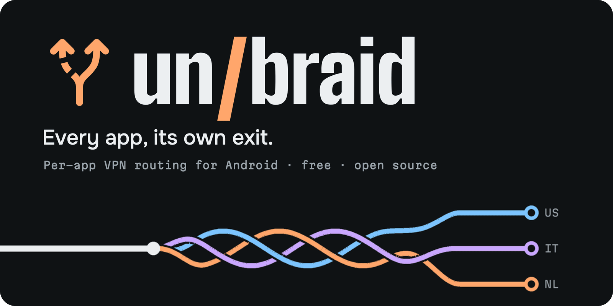
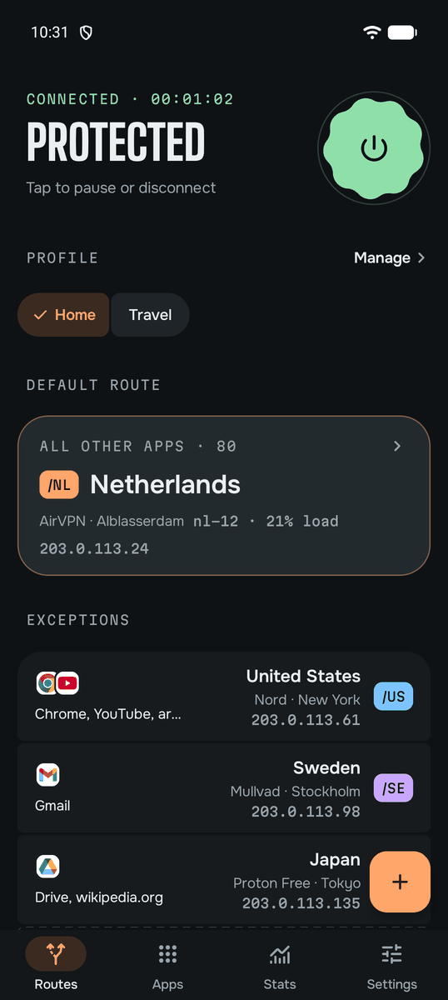
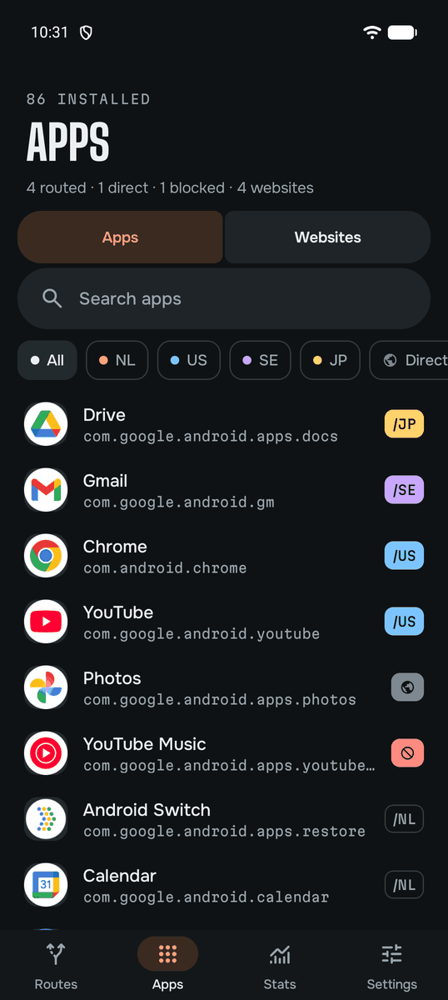
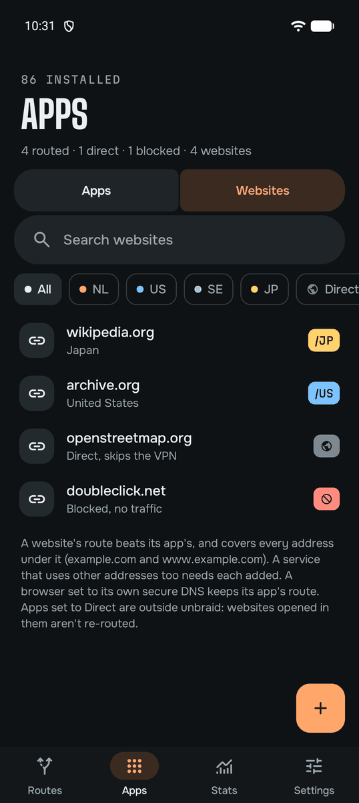
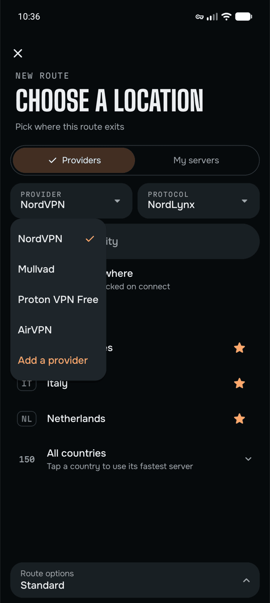
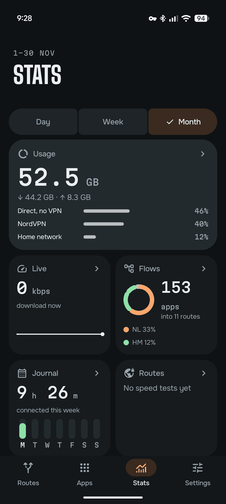

<p align="center">
  
</p>

<p align="center">
  <a href="https://github.com/quiet-crafts/unbraid/releases/latest"></a>
  
  <a href="LICENSE"></a>
  <a href="https://unbraid.app"></a>
  <a href="https://github.com/quiet-crafts/unbraid-mac"></a>
</p>

unbraid is a free Android app that lets every app on your phone use a different VPN connection, or none at all.
Your banking app can use your normal connection, a streaming app can appear to be in the US, another app in Italy,
and everything else in the Netherlands, all at the same time. This is called split tunneling: instead of one tunnel
for the whole phone, each app gets its own.

unbraid is only the app: you bring the accounts you already have (NordVPN, Mullvad, Proton VPN and
others), your own server, or a free plan, and unbraid connects to several of them at once. Tailscale, a private
network between your own devices, is built in too, so you can reach your computers at home while apps use their VPNs.

<p align="center">
  <a href="https://github.com/quiet-crafts/unbraid/releases/latest"><b>Download the APK</b></a>
  &nbsp;·&nbsp; <a href="https://unbraid.app/download/#obtainium">Add to Obtainium</a>
  &nbsp;·&nbsp; <a href="https://github.com/quiet-crafts/unbraid-mac">unbraid for Mac</a>
  &nbsp;·&nbsp; <a href="https://unbraid.app">Website</a>
  &nbsp;·&nbsp; <a href="https://www.youtube.com/watch?v=aqTlrJdAUgw">Watch the 2-minute video</a>
  &nbsp;·&nbsp; <a href="https://unbraid.app/privacy">Privacy policy</a>
  &nbsp;·&nbsp; <a href="https://github.com/quiet-crafts/unbraid/issues">Report a bug</a>
</p>

<table align="center">
  <tr>
    <td align="center" width="20%"></td>
    <td align="center" width="20%"></td>
    <td align="center" width="20%"></td>
    <td align="center" width="20%"></td>
    <td align="center" width="20%"></td>
  </tr>
  <tr>
    <td align="center"><sub>Each app gets its own exit</sub></td>
    <td align="center"><sub>See every app's route at a glance</sub></td>
    <td align="center"><sub>Route or block a website</sub></td>
    <td align="center"><sub>Mix providers and countries</sub></td>
    <td align="center"><sub>Usage, speed and connected time</sub></td>
  </tr>
</table>

There is also [unbraid for Mac](https://github.com/quiet-crafts/unbraid-mac), with the same idea and the same
providers. It needs macOS 26 or later.

## What you can do

A *route* is a path to the internet that you name in unbraid, and its *exit* is where your
traffic comes out: a VPN server in a country you pick, your home, or *Direct*, which means your normal connection
without a VPN. Every app follows the *default route* unless you give it one of its own.

- Give any app its own exit country or server, let it follow the default route, or keep it off the VPN with
  Direct. Several exits stay connected at once.
- Give a website its own route too, in the apps that go through unbraid. A website's route wins over the app's.
- Block an app or a website. A blocked app gets no internet connection while unbraid is connected.
- Use the VPN accounts you already have, and mix them: one route can go through Mullvad while another uses NordVPN.
- Send apps through a proxy app on the same phone, such as v2RayTun, which helps where VPNs are blocked. unbraid
  works with any app that offers a SOCKS5 proxy (a common, simple way for apps to hand traffic to each other), for
  chosen apps or as the default route.
- Chain two servers: a WireGuard route can go through another route first (*Via*), even one from another provider,
  so the second server sees the first server's address instead of yours. IVPN's own multi-hop works too.
- Get through networks that block VPNs: IVPN's V2Ray disguise, junk packets before each WireGuard connection starts,
  and OpenVPN over TCP for AirVPN and NordVPN (much slower). AirVPN's *Automatic* can switch to it by itself when
  WireGuard stops answering, with an API-key sign-in and on routes without a Via.
- With IVPN, each sign-in adds a Kyber key, which protects recorded traffic against future quantum computers. By
  default unbraid asks for a new key when it connects and the key is a week old.
- Reach your home network through Tailscale, Headscale (a Tailscale server you run yourself) or your router's
  WireGuard config, or send chosen apps out through a Tailscale exit node, such as a computer at home. Sign in to
  Tailscale or Headscale with your browser or with an auth key.
- Let unbraid pick a server with little load when the provider publishes it, or pin one server yourself. If a
  provider's server keeps failing, unbraid can move to another port or another server that matches your choice
  (pinned servers and imported configs keep theirs).
- Block ads and trackers per route with the provider's own blocking, where it has some, or use a DNS filter
  instead: AdGuard DNS, AdGuard DNS Family, Cloudflare 1.1.1.2 or 1.1.1.3, NextDNS, Quad9, or a DNS server of your
  own. You choose whether it covers your VPN routes, Direct traffic or single Direct apps.
- Save setups as profiles and let them switch by themselves on Wi-Fi and on mobile data. There are home-screen
  widgets, a quick-settings tile, and a pause that reconnects by itself.
- Back up your setup to a file locked with a passphrase, and restore it on this phone or a new one.
- See stats on the phone: data per provider, app and routed website, when you were connected over the last 13
  weeks, and speed tests across several exits at once.
- No ads, no unbraid account and no analytics of our own. unbraid is free software under the GPL.

## What it works with

You bring the VPN. unbraid has no servers of its own and works with the accounts and servers you already have.

You can sign in with NordVPN (NordLynx, OpenVPN, Double VPN and Onion over VPN), Mullvad, Private Internet Access,
IVPN, AirVPN (with an API key) or ExpressVPN. For Surfshark you add your WireGuard key once, and for Windscribe (or
AirVPN without an API key) you paste one WireGuard config from their website. After that you choose from the servers
your plan includes.

For Proton VPN, the Free plan included, you add the whole WireGuard config file of the server you want, and unbraid
checks the server against that file. For more Proton servers, import their config files under *Own servers*.

You can also import your own WireGuard or OpenVPN config, paste a Shadowsocks key, add a SOCKS5 proxy that another
app runs on the phone, or join a Tailscale network (a self-hosted Headscale works as well).

## Getting started

1. Download the APK from the [releases page](https://github.com/quiet-crafts/unbraid/releases/latest) and open it
   on your phone to install it. Android may ask you to allow installs from your browser or file manager first.
   If you use [Obtainium](https://obtainium.imranr.dev/), add unbraid from
   [unbraid.app/download](https://unbraid.app/download/#obtainium) instead: it installs the same APK and tells you
   when there's an update.
2. Turn off any other VPN app, including your provider's own app, and its "Always-on VPN" setting. Android only
   lets one VPN app run at a time.
3. Open unbraid, accept the terms and choose your VPN. You can sign in to a provider, import a WireGuard or
   OpenVPN file, paste a Shadowsocks key, or use Tailscale on its own. Proxy servers are added later, in Settings.
4. On the Routes tab, tap the default route, choose Change location and pick a country. This is where every app
   goes unless you say otherwise. If you imported a file, its server is already set. Then tap the power button to
   connect and allow the VPN when Android asks. With Tailscale on its own, open Settings, then Tailscale, and tap
   Sign in with your browser (it connects first) or Sign in with an auth key.
5. To send some apps somewhere else, tap +, then Route, and choose another country or server. Open the Apps tab
   and tap Show my apps (the list stays on your phone). Then tap an app and pick its route. Pick Direct for apps
   that should not use the VPN at all, like a banking app, or Block for an app that should get no internet connection.
6. To route a website, switch the Apps tab to Websites, tap +, type its address and pick a route. It applies in
   the apps that go through unbraid and look names up through it.

Each release lists the APK's SHA-256 checksum and the fingerprint of the signing certificate, two ways to check that
the file really comes from us. [unbraid.app/download](https://unbraid.app/download/) explains how to check them
before you install.

## Good to know

unbraid has no servers, so you need an account with a supported provider (the free Proton VPN plan works), a
server of your own, or a proxy app.

Android runs only one VPN app at a time, so unbraid takes the place of your provider's app while it is on. If you
connect another VPN app, Android stops unbraid. If you allow its notifications, unbraid tells you it is off.

Your provider's limits still apply. Providers with a connection limit count each route in use as a connection,
while Mullvad counts unbraid as one device. The default route stays connected while unbraid is on. Other routes
connect as soon as an app is assigned to them, even if that app is idle.

Apps that go through unbraid use IPv4 only (the older, most common kind of internet address), and IPv6 is blocked
for them. Apps that Android leaves outside the VPN can still use your normal IPv6.

The app needs Android 13 or later on a 64-bit ARM phone. To update, download the new APK from the releases page and
install it over the old one; your settings stay. The GitHub version can also check for a newer version about once a
day. From 3.2.2 that's on by default, also where it was off before, and it shows a notification when one is out.
Turn it off in Settings, About & support. It asks unbraid.app for a small file and identifies itself only as
"unbraid" and its version, such as "unbraid/3.2.2".

## Questions

### How is this different from the split tunneling in my VPN app?

In many VPN apps, split tunneling means you can pick apps that skip the VPN, while every other app leaves from the
same place. unbraid lets you choose an exit for each app, and those exits can come from different providers.

### Can I route a website and not a whole app?

Yes. On the Apps tab, the Websites list gives an address its own route, Direct or Block, and that beats the route
of the app that opens it. A rule covers the address and everything under it (example.com and www.example.com); a
service that uses other addresses needs each one added.

unbraid knows a website by the name the app looks up, so the rule does not reach apps that Android keeps outside the
VPN, such as apps set to Direct, or a browser that uses its own secure DNS, which keeps its app's route.

A change to a website rule, or to a setting that decides whether it applies (Local network bypasses the VPN, Reach
your tailnet), takes effect for connections made after the app looks the name up again. An app that kept an address
from before the change follows the old path until it does; reopening the app or the page usually does it. (That holds
for an address a name really has. A stand-in address kept for a name that one of your saved website rules covers, and
that your local network or your tailnet has since taken over, is refused until the app looks the name up again.)

Names that your local network or your tailnet answer (such as printer.lan, or your tailnet's own names) go to them
first, so a website rule doesn't apply to those while that setting is on, and the list says so. A route used only by
such a "Not applied" website still keeps its VPN connection open. A shared ending such as co.uk or gov.au can't be
added, as it would cover every website that ends in it; add the website itself.

### What does Block do?

An app on Block gets no internet connection while unbraid is connected: not through a route, not Direct, and no
names are looked up for it. A switch decides whether it can still reach devices on your local network. Block works
only while unbraid is connected; for the time it is off, use Android's "Block connections without VPN".

While any app is blocked, unbraid refuses pings and connections that Android can't tie to an app, and a name lookup
Android can't tie to an app is refused for tailnet names. Local names use the local resolver if the switch allows it.
For other permitted names, address lookups get a stand-in, HTTPS and SVCB lookups get an empty answer, and other
record types are refused. A blocked website can't be looked up in the apps that go through unbraid, unless a more
specific website under it has a route of its own.

### Why isn't it on Google Play?

Google only accepts VPN apps from developer accounts registered as an organisation, with a D-U-N-S business number
and a verified legal name and address. unbraid is a small project made by one person, and we've chosen not to
register that way, so there are no plans to publish it there. The APK on the releases page is the complete app.

### Can I use it without a VPN subscription?

Yes. The free Proton VPN plan works, and so does a server of your own. You can import a WireGuard or OpenVPN file,
paste a Shadowsocks key, use a proxy app on the phone, or use only Tailscale, for example with an exit node at home.

### Can I use Tailscale and a VPN at the same time?

Yes. Tailscale is built in, so you don't need the Tailscale app, which Android would stop anyway, since it runs one
VPN app at a time. Apps routed through unbraid can reach your tailnet devices and their MagicDNS names while their
internet traffic uses a VPN exit, and a Tailscale exit node can be a route's exit. All Tailscale routes share one exit
node.

For now unbraid only connects out: other tailnet devices can't open connections to apps on the phone, and Taildrop
and Tailscale SSH are off. Letting them in, as options you turn on, is being worked on.

### Can I reach my home network while I use a VPN?

Yes. With Tailscale, or with your router's WireGuard config added as a home tunnel, apps can reach devices at home
and still use their VPN exit for everything else.

### Does it have a kill switch?

A kill switch keeps apps offline when the VPN isn't running. unbraid works with Android's own "Always-on VPN" and
"Block connections without VPN" settings, which you can open from the app's settings. With blocking on, apps cannot
go online without unbraid, Direct apps included. Apps you set to Direct still use your normal connection while
unbraid is connected, and unbraid's own requests can still go online (see Privacy). Apps in a work profile are
outside this VPN.

If unbraid can't open its saved settings, it keeps apps offline until you retry or start fresh, and an app whose
chosen route no longer exists is blocked rather than sent out over your normal connection.

### Can I use a proxy app like v2RayTun?

Yes, if it offers a SOCKS5 proxy on the phone. Start its proxy mode, then in unbraid open Settings, Providers &
servers, Add connection, Proxy server, and choose the app, its port and its login if it has one. You can pick the
proxy for single apps or make it the default route.

Before unbraid sends a connection or a password, it checks that the port belongs to the app you chose. Calls and
video (UDP) are off until you turn them on in the proxy server's settings. The proxy app itself stays on Direct, and
unbraid refuses changes that would break that. If the proxy app stops while unbraid runs, the apps whose route is the
proxy are offline rather than going around it (website, home network and local network rules still come first).

Android's "Block connections without VPN" can't be used together with a proxy server, so turn on Always-on VPN only.
A proxy server can't be used for website routes.

### Does it get around my provider's device limit?

No. Providers with a connection limit count each route in use against it. Mullvad counts unbraid as one device.

## How it works

Android allows one VPN app at a time, so unbraid runs a single `VpnService` with one TUN interface and the
[sing-box](https://github.com/SagerNet/sing-box) engine behind it.

```
apps -> TUN -> sing-box -> rules: block, DNS, home, LAN, website routes, the app's route, default
                           |- one WireGuard, OpenVPN or Shadowsocks exit per location
                           |- a SOCKS5 proxy app on the phone
                           |- Tailscale node (home)
                           '- direct
```

Each TCP and UDP connection is routed by the app that owns it, which Android reports through
`ConnectivityManager.getConnectionOwnerUid`. If Android cannot identify the owner of a TCP or UDP connection and an
app in the tunnel has its own route, unbraid refuses the connection before it can use the default route. Website and
network rules still run first. When an app hands a connection to another app or system service, such as for a
download, a browser tab or a push message, that connection follows the other app or service's route.

Ping has no owning app, so it follows the default route. When Direct is the default and other apps use VPN routes,
or a proxy server is the default, internet ping is refused instead.

DNS is answered with fake addresses and looked up again on the exit the app really uses, so a site sees the country
you picked for that app, or for that website when it has a route of its own.

Apps you set to Direct are left out of the VPN by Android itself, unless you turn on "Block connections without VPN"
or set the DNS filter to cover Direct traffic. Then they go through unbraid and are sent straight out from inside the
app. Android does this by user id, which a few apps share (such as Google Play services and Google Services
Framework). An app set to Direct that shares one with an app that uses a VPN route or Block goes as that app does,
filtered or not, and its Apps menu says so. While connected, unbraid applies your setup again when an app with a saved
choice is installed, or when an install or removal changes which apps share a user id. Apps that only follow a Direct
default route always go through unbraid.

Only the default route, the routes your apps and websites use, and the routes those go *Via* with two tunnels are
connected.

A restored app assignment waits up to 30 days for the matching signed app to be installed. An app installed later
follows the default until you choose a route for it in Apps. With a Direct default, its traffic still passes through
unbraid. An expired Direct assignment cannot put it outside the VPN.

A website rule matches the name unbraid itself answered with a fake address, never a name read from the connection,
so an app can't claim another site's route. When a local network or home rule takes a connection, unbraid dials only
the addresses that rule covers, even if the name's answer also holds public addresses. Blocked apps are refused before any other rule, DNS included.

When a change can't be made ready or the engine can't start it, the setup that ran before stays or comes back as it
was, on the newest block, and the app shows why the change was not applied: until a later change applies, the
earlier setup stays in force, also for the apps, websites and settings the change was about. If the setup from
before can't start either, apps inside the VPN stay offline instead of going online without it: unbraid says so and
keeps trying, more slowly over time and at once after an edit, a restore, a sign-in, a new app or a network change.
Apps set to Direct keep working. The same holds when a move's start fails and the setup from before then can't start
on the new block either. If Android refuses even the tunnel that keeps apps offline, unbraid says some apps may be
online and tries again soon.

For NordVPN, unbraid picks a server from the provider's low-load recommendations when it connects, unless you
pinned one. Server lists come from each provider's public API where there is one, and otherwise from
[gluetun-servers](https://github.com/qdm12/gluetun-servers).

## Build

You need JDK 17 or newer, Android SDK 37, NDK 28 and Go 1.26 (Go fetches the exact toolchain itself through
`GOTOOLCHAIN`).

```bash
tools/build-libbox.sh                 # builds app/libs/libbox.aar from sing-box v1.14.4 with the patches in tools/
./gradlew :app:assembleFossRelease    # the APK published here, without Google Play Billing
./gradlew :app:bundlePlayRelease      # a variant with a tip jar through Google Play Billing; not published
./gradlew :app:testFossDebugUnitTest
```

The build script keeps its work files in `~/.cache/unbraid-libbox`. Set `WORK` to use another folder. The patches
in `tools/` stop libbox from writing the running configuration, which holds private keys, to disk, seal the
Tailscale node state with an Android Keystore key, refuse files sent through Taildrop, give an OpenVPN tunnel a
resolver inside it when its server pushes none, add the Kyber key exchange IVPN uses for its extra WireGuard key, send
optional junk packets before each WireGuard handshake, let the app's connection checks look up their servers through
the tunnel being checked, release every network part a tunnel built when it stops or fails to start, send a connection
that the local network or home rules take to only the addresses those rules cover, and never
hand a stand-in (fake) address to a second name while its table lives: a used-up block of them answers new names
with a failure, and the app moves to the next of eight blocks, with a new table, when less than a quarter of the block
is left, at most once every 10 minutes (a block that runs low sooner moves at the first check after those 10 minutes).
While a block is low, each app Android can identify has a limited share of new addresses. Lookups from shared or
unidentified callers draw from one larger share. A caller that uses its share can still look up names already in the
table. While the table has free addresses, other callers can resolve new names up to their own limits.
The no-reuse guarantee holds across crashes and across any error the engine's cache reports (a
failed read or write, a damaged file): the table then hands out no more addresses, as if used up. After such an error
within 10 minutes of the last block change, new names fail until those 10 minutes are up; then the app moves to a new
block. A fresh connect is not affected: it always starts on the next block. A cache file changed without any error is
not covered: it is the app's own private file, deleted at every connect, app start and new block (only the engine that keeps
apps offline while the saved settings can't be read starts even when that delete failed). A block apps were using comes back only after
the seven others, so an address an app kept longer than that (across eight moves, reconnects or pauses) can name
another site by then; apps that keep an old block's address are refused until they look the name up again. A move
restarts the setup the engine runs on the next block, so a change it refused before stays refused; one that can't get
ready (the old table not deleted, its block not saved) leaves the current engine running and is tried again at the next
check, 15 seconds later; if the old table was deleted but the block could not be saved, a settings change made meanwhile
takes a new block. If the app is killed in the instant between saving a new block's number and starting on it, that
block is skipped, so in that rare case a block can come back after six others, not seven. After a cache error, new
names fail until the next block move, except that if removing the cache's saved position also fails and the storage
recovers at once, a settings change may resume handing out addresses on the same block sooner (still never giving an
address to a second name).

A release build is signed only if `.secrets/signing.properties` exists, so a plain checkout builds an unsigned APK.

## Privacy

unbraid has no advertising or analytics of its own, and you don't need an unbraid account.

Your provider logins are encrypted with an Android Keystore key and are only sent to the service they belong to.
The app's own requests use your phone's normal connection, not the VPN, so those services see your own IP address.
These are provider sign-ins and key changes, server lists, the update check (on by default from 3.2.2, once a day,
sending only the app's name and version; off in Settings, About & support), a server's history from AirVPN when you
tap to ask, and the direct connectivity check when every tunnel checked in a round fails.

unbraid reads the list of installed apps on the phone so you can assign routes, and that list never leaves the
phone. "Copy a report" in the app's settings only copies text to the clipboard: the phone model, Android version,
app version, which providers and countries you use, and counts. It holds no keys, accounts, addresses or app names.

App data is left out of Android's own backups. A backup file you save in Settings is locked with your passphrase
([how](SECURITY.md#backup-files)) and stays wherever you save it. Your own servers' keys and passwords go in only if
you choose, and provider sign-ins never do. The privacy policy, with every service the app talks to, is at
[unbraid.app/privacy](https://unbraid.app/privacy).

To report a security problem, see [SECURITY.md](SECURITY.md).

## Support the project

unbraid is free and has no paid features. If it is useful to you, see
[unbraid.app/donate](https://unbraid.app/donate/) for ways to support it. A donation doesn't unlock anything.

Bug reports are welcome in the [issue tracker](https://github.com/quiet-crafts/unbraid/issues). The project
doesn't take pull requests. [CONTRIBUTING.md](CONTRIBUTING.md) explains why and how else you can help.

## Licence

unbraid is free software under the GNU General Public License, version 3 or (at your option) any later version.
See [LICENSE](LICENSE). sing-box, which unbraid is built on, is under the GPL as well.

unbraid includes or downloads work by other people under their own licences. [THIRD-PARTY.md](THIRD-PARTY.md)
lists them, and the full texts ship inside the app (`app/src/main/assets/notices.txt`, generated by
`tools/notices.sh` from the Go modules that are actually linked).

unbraid is an independent project and isn't affiliated with or endorsed by the VPN providers named here,
Tailscale or SagerNet. Product names belong to their owners.

## About this repository

unbraid is published by Quiet Crafts. Parts of the code and of the text in this repository were written with the
help of AI tools. The developer reviews and tests every change before it is released.
